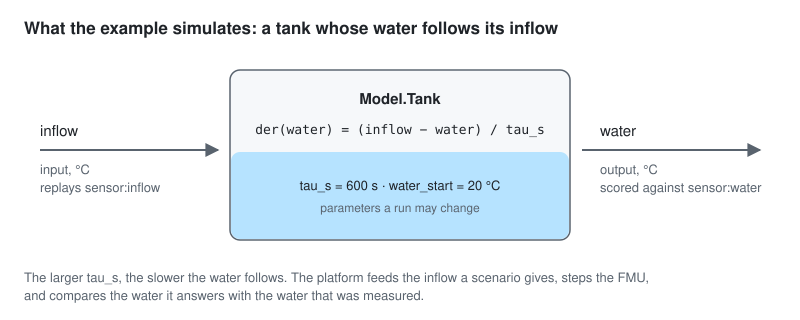
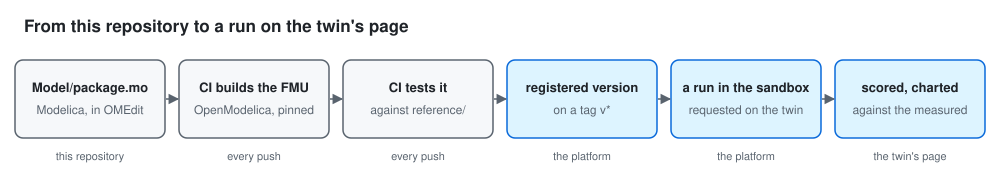
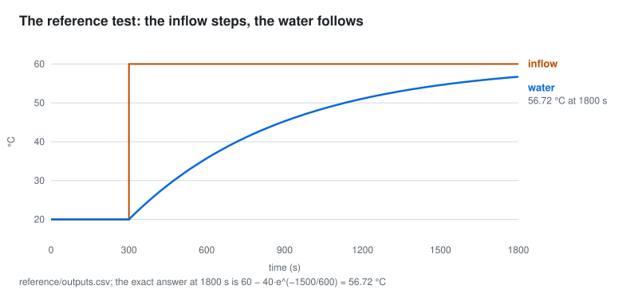
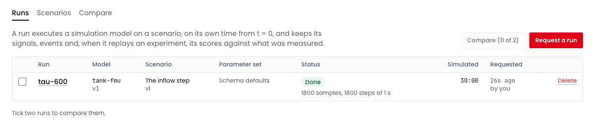
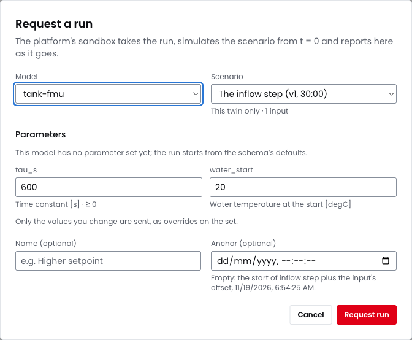
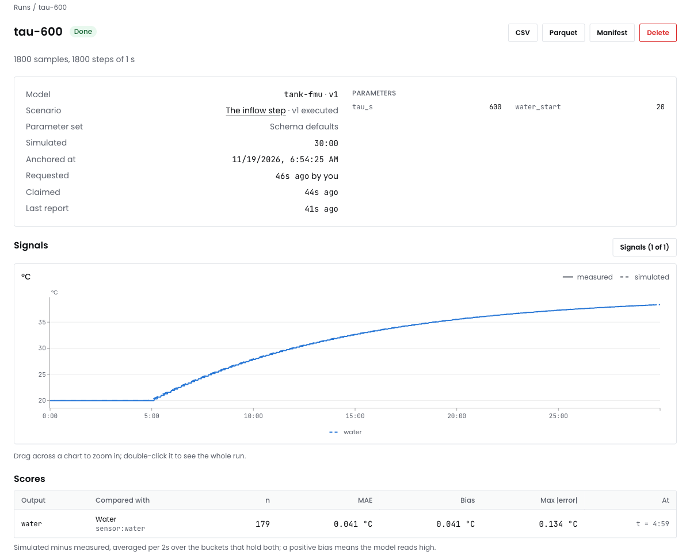

# A Modelica model for the twin platform

Start a model here. You write it in [Modelica](https://modelica.org), and this repository's CI
builds it into an FMU with [OpenModelica](https://openmodelica.org). An FMU is the
Functional Mock-up Interface's package of a model, its description and its solver in one file.
CI then holds the FMU to a reference result. On a tag, it registers the FMU as your model's next
version on the [twin platform](https://dtp.twinhub.nl), whose sandbox runs it when someone
requests a run on the twin's page. The guide
[Your model on the platform](https://dtp.twinhub.nl/learn/your-model-on-the-platform) walks
through it from the start.

⚠️ On dtp.twinhub.nl the sandbox runs a kind's models once a platform admin has given it a
credential for that kind: ask for it when you become a model author, or a run waits `requested`.

The example is a tank whose water follows its inflow: `der(water) = (inflow - water) / tau_s`.





| File | What it is |
| --- | --- |
| `Model/package.mo` | the Modelica package; `Model.Tank` is the model |
| `build.mos` | OpenModelica's script that exports it: FMI 2.0 co-simulation, CVODE inside |
| `model.toml` | the FMU's name, the model's id, OpenModelica's pinned image, the Modelica libraries at their commits, how each input meets a run's grid, what it replays and is scored against, the reference test's tolerance |
| `reference/inputs.csv`, `reference/outputs.csv` | inputs fed to the FMU one row per step, and the outputs they must give |
| `scripts/model.py` | `build`, `test`, `entry` and `register`, all reading `model.toml` |
| `docs/model.md`, `docs/diagram.svg` | the model's guide and its picture, registered with each version and shown on the model's card on the platform |
| `.github/workflows/ci.yml` | the build and the test on every push; the registration on a tag `v*` |

## Start

1. **Use this template** (the green button on GitHub) to make your own repository, and clone it.
2. Install [uv](https://docs.astral.sh/uv/) and Docker, then run `uv sync`. It installs `twinhub`,
   the platform's SDK, from the platform's package index, and FMPy, which reads and runs FMUs.

## Change the model

Edit `Model/package.mo` in OMEdit (OpenModelica's editor) or as text. Each `input` and `output` is
what the platform feeds and reads, and each `parameter` is a run's parameter with its default. A
variable's `unit` must be the unit the kind declares for it. When you rename the model or the
package, change `build.mos` (the class and `fileNamePrefix`) and `fmu` in `model.toml` with it.

**Libraries.** The tank uses the Modelica Standard Library's units. `model.toml` names every
library the model uses as a git repository at a full commit: the Standard Library is v4.1.0, as
`uses` in `Model/package.mo` says, in OpenModelica's own distribution, whose `ModelicaServices`
finds a data file inside an FMU. `build` fetches each one into `build/libraries/` once, then
builds with no network, so a version on the platform was built from exactly those commits. To use
another library, such as LBNL's [Buildings](https://github.com/lbl-srg/modelica-buildings), add
its repository and the commit of a release under `[libraries]`, and its `uses` to your package.
OMEdit brings its own copy of the Standard Library; open the same version there.

**Data files.** A table the model reads, a route or a measured curve, goes in the package's
`Resources/` folder, and the model names it through `loadResource`, for instance a
`CombiTable1Ds` with `tableOnFile = true` and
`fileName = Modelica.Utilities.Files.loadResource("modelica://Model/Resources/<file>")`. The
build puts it inside the FMU, where the sandbox's run reads it: no data file is copied into
Modelica code, whatever its size.

**A table file per run.** When a run should choose the table, a route or a weather year, the
model takes the file's path as a top-level `parameter String` with the default `""` (and reads its
built-in file when it is empty), and `model.toml` declares it under `[table_files.<parameter>]`
with its `format`, `"tables"` or the platform's `"road_route"`, and a `description`. A scenario
then carries the tables, the sandbox writes them to a file and sets the parameter to its path, and
the parameter leaves the run dialog. A model whose outputs are where it is names them under
`[position]` (`lat` and `lon`, in degrees), and the platform draws its runs on a map. The tank
needs neither. A `road_route` file holds a table `route`, a row per point along the road
(distance m, strictly increasing, planned speed m/s, speed limit m/s, latitude and longitude deg),
and a table `lights` (index, distance m, red time s, its last row far past the route).

```toml
[table_files.routeFile]
format = "road_route"
description = "The route the vehicle drives"

[position]
lat = "lat"
lon = "lon"
```

```sh
uv run python scripts/model.py build   # Tank.fmu, built for Linux x86-64 in OpenModelica's image
uv run python scripts/model.py entry   # the kind's models entry, read from the FMU
```

The build runs OpenModelica's Linux image. On an Apple-silicon Mac, Docker emulates it, which is
slower. `test` loads the FMU's Linux x86-64 binary, so it runs in CI, or on a Linux x86-64
machine:

```sh
uv run python scripts/model.py test           # the FMU against reference/, within the tolerance
uv run python scripts/model.py test --write   # reference/outputs.csv from the FMU, after a change
```



`reference/inputs.csv` starts at time 0, as every run does. Rewrite the reference only when
you mean the model's answer to change, and check the new numbers
before you commit them. For the tank, the answer is known: after the inflow steps from 20 to
60 °C at 300 s, `water = 60 - 40·exp(-(t - 300)/600)`. Put inputs into `reference/inputs.csv` that
exercise your model. Each row is held over the step to the next, as the sandbox holds a run's
inputs over each step.

## Put it on the platform

1. **The kind.** The model belongs to a kind, the platform's description of a sort of twin. Put
   the printed entry in the kind's `models`. `entry` takes what the FMU cannot say from
   `model.toml`: each input's `policy` and `max_gap_s`, the measured channel it `replays`, and
   the channel each output is scored against (`compares_to`). The guide shows a whole kind.
2. **Become a model author.** A platform admin makes you a model author of your org. Until then,
   a registration is refused.
3. **Tell CI where to register.** Under *Settings › Secrets and variables › Actions*, add the
   secret `TWINHUB_TOKEN`, your personal token from the platform's *Account › API tokens*, made with the **write** scope, and
   the variable `TWIN_ID`, a twin of the kind. Add `TWINHUB_URL` only for a platform other than
   `https://dtp.twinhub.nl`.
4. **Tag.** `git tag v1 && git push --tags`. CI builds, tests and registers the FMU, naming the
   commit it was built from and the OpenModelica release that built it. The platform refuses an
   FMU it cannot run, or one that differs from the kind's entry, and the job's log names the
   reason (the guide lists them).

`register` also sends the repository the commit is in, so the platform links to the code that
ran, and `docs/model.md` and `docs/diagram.svg`: the guide and the picture the model's card shows
beside its inputs, outputs and parameters. Write the guide for someone who meets the model on the
platform (what it is, where its equations are, what to change), and keep both with the model.
`uv run python scripts/model.py register --dry-run` prints what it would send, sending nothing.

A new version serves the runs requested after it.

## On the twin's page

The twin's **Models › Runs** lists its runs, the model version each ran and how it ended:



**Request a run** picks the model, a scenario and the parameters, which the FMU's own parameters
shape, with their units and bounds:



The sandbox runs it with no machine of yours alive. The run's page charts the simulated water,
dashed, over the measured water, and scores one against the other:



## Licence

Apache-2.0. A repository made from this template is yours to licence.
